<h1 align="center">QA Superteam</h1>

<p align="center">
  <strong>Turn your coding agent into an evidence-first QA engineering team.</strong><br>
  It works out what your software should do, runs your real tests, has every serious bug independently verified,<br>
  and decides <code>PASS</code>, <code>REVIEW_REQUIRED</code> or <code>BLOCK</code> from an explicit policy, not from a model's opinion.
</p>

<p align="center">
  <a href="https://github.com/Yazeedx0/qa-superteam/actions/workflows/ci.yml"></a>
  <a href="LICENSE"></a>
  
  <a href="https://agentskills.io"></a>
  
  
</p>

<p align="center">
  
</p>

<p align="center"><sub>A PR review on the bundled demo API. The pull request breaks a money rule, and QA Superteam catches it, proves it and blocks the release.<br>Every status, ID and decision shown comes from a real run: <a href="examples/reports/backend-pr-review/report.md">see the full report</a>.</sub></p>

<p align="center">
  <a href="#install">Install</a> ·
  <a href="#quick-start">Quick start</a> ·
  <a href="#how-it-works">How it works</a> ·
  <a href="#does-it-actually-work">Results</a> ·
  <a href="docs/">Docs</a> ·
  <a href="CONTRIBUTING.md">Contributing</a>
</p>

---

## Why

AI coding assistants are good at writing tests and plausible bug reports. They are just as
good at writing tests that assert nothing, reporting results nobody ran, and confirming
"bugs" that vanish when someone tries to reproduce them.

QA Superteam starts from the questions an experienced QA team asks:

- What is this supposed to do, and which rules must never break?
- What changed, and what could it break?
- Can we reproduce the problem, and can someone else confirm it?
- What did we *not* test?
- Is this safe to ship?

It enforces the answers **in code**, not just in prompts:

| Guarantee | How it is enforced |
|---|---|
| No result is claimed without running it | Tests run through `qast`, which wraps your real tools and records what actually happened, using seven statuses rather than pass/fail |
| Skipped, blocked or flaky is never "passed" | A mandatory check that did not run cleanly can never produce `PASS` |
| A bug is confirmed only after independent verification | `qast verify` refuses `CONFIRMED` unless a *different* agent re-ran the test itself and saw it fail |
| Evidence can be trusted | Records are write-once; logs and reports are redacted for secrets and hashed (sha256) |
| The release decision is reproducible | A deterministic policy engine, unit-tested: same evidence, same decision |
| Your repo stays safe | Read-only by default; local targets only; while a QA run is active, a hook asks before risky commands |

**How it differs from AI code review:** code review reads code and gives opinions. QA
Superteam executes your software. Reading code alone never confirms a bug.

**How it differs from test generation:** generators maximize test count. QA Superteam
spends effort where risk is highest, prefers your existing tests, gives every new test an
explicit pass/fail condition, and declines testing that would not change the release decision.

## Install

You need **Python 3.11+** (for the bundled `qast` tool, with no packages to install) and git.

### Any coding agent

Use the open [`skills`](https://skills.sh) installer, which needs Node 22.20+. It supports
Claude Code, Codex, Cursor, Gemini CLI, GitHub Copilot, OpenCode, Windsurf, Cline, Roo
Code, Kiro, Goose, Amp, Qwen Code and
[about 70 more](https://github.com/vercel-labs/skills/blob/main/docs/agents.md):

```bash
npx skills add Yazeedx0/qa-superteam                           # choose agents interactively (project scope)
npx skills add Yazeedx0/qa-superteam -g -a codex -a cursor -y   # user-wide, for specific agents
```

Outside Claude Code, `qast` ships inside the entry skill, for example
`.agents/skills/using-qa-superteam/scripts/qast doctor`. The skills tell the agent where to
find it.

### Claude Code: full plugin

The plugin adds the 12 specialist agents, the safety hooks and `qast` on your `PATH`:

```bash
claude plugin marketplace add Yazeedx0/qa-superteam
claude plugin install qa-superteam@qa-superteam      # add --scope project to share it with your team
```

In a session: `/plugin marketplace add Yazeedx0/qa-superteam`, then
`/plugin install qa-superteam@qa-superteam`.

<details>
<summary><b>Claude plugin directory edition</b> (skills and agents only, without <code>qast</code>)</summary>

`plugins/qa-superteam/` is the instruction-only edition submitted to Anthropic's plugin directory,
which accepts hooks, executables and scripts only from Verified organizations. It carries the same
skills and agents without the `qast` runtime and the safety hooks: steps that need recorded
execution report `BLOCKED (qast not installed)` and no release decision is produced. Use the full
plugin above for evidence and the gate. The edition is generated by
`scripts/build_directory_plugin.py`; CI fails if it drifts from `skills/` and `agents/`.
</details>

<details>
<summary><b>Native plugins for other agents</b> (manifests included; not yet tested in those agents)</summary>

| Agent | Install |
|---|---|
| Gemini CLI | `gemini extensions install https://github.com/Yazeedx0/qa-superteam` |
| GitHub Copilot CLI | `copilot plugin marketplace add Yazeedx0/qa-superteam`, then `copilot plugin install qa-superteam@qa-superteam` |
| Factory Droid | `droid plugin marketplace add https://github.com/Yazeedx0/qa-superteam`, then `droid plugin install qa-superteam@qa-superteam` |
| Qwen Code | `qwen extensions install Yazeedx0/qa-superteam` |
| Codex | `.codex-plugin/plugin.json` + `.agents/plugins/marketplace.json` |
| Cursor | `.cursor-plugin/plugin.json` (with a session-start hook) |

`npx skills add` above is the tested path for these agents. See
[docs/compatibility.md](docs/compatibility.md).
</details>

Check your setup from any project with `qast doctor`. It lists which test tools are
available and how to install the missing ones.

## Quick start

1. Open your project in your coding agent with QA Superteam installed.
2. Optional: `qast init` writes `.qa-superteam/config.toml` with safe defaults. Set
   `write_tests = true` if QA may add test files under `tests/qa/`.
3. Ask for what you need:

| You want to | Run (Claude Code) or ask for it in any agent |
|---|---|
| Audit a whole repository | `/qa-superteam:full-audit` |
| QA a branch or pull request | `/qa-superteam:review-pr main` |
| Test one feature or user story | `/qa-superteam:test-feature "<story>"` |
| Test an API | `/qa-superteam:test-api` |
| Test browser journeys | `/qa-superteam:test-e2e` |
| Run a security review | `/qa-superteam:security-review` |
| Evaluate an LLM, RAG or agent system | `/qa-superteam:eval-ai` |
| Run time-boxed exploratory testing | `/qa-superteam:explore` |
| Reproduce and verify a bug | `/qa-superteam:verify-bug "<report>"` |
| Select and run regression tests | `/qa-superteam:regression main` |
| Make a go / no-go call | `/qa-superteam:release-check` |
| Improve an existing test suite | `/qa-superteam:improve-suite` |

Or just ask, for example "is this branch safe to release?". The entry skill routes the
request to the right workflow.

**Try it on the bundled demo apps.** They contain deliberately planted bugs with a hidden
answer key:

```bash
git clone https://github.com/Yazeedx0/qa-superteam && cd qa-superteam/examples/backend-api
claude --plugin-dir ../..          # then: /qa-superteam:full-audit
```

To see the whole pipeline without an agent, run `python3 scripts/demo_pipeline.py --scenario all`.

## How it works

```text
  you ─▶ /qa-superteam:<workflow>   the main agent acts as QA Lead
            │   loads only the methodology skills it needs (requirements, risk, test design, ...)
            │   delegates bounded tasks ─▶ specialist agents (they cannot delegate further)
            ▼
         qast   deterministic tool layer · stdlib Python · bundled with the skills
            ├─ discover · impact · risk          understand the project and the change
            ├─ record requirements / plan        validated JSON records
            ├─ exec <adapter>                    pytest · JUnit · Vitest · Jest · Playwright · k6
            │                                    axe-core · AI evals · Bandit · pip-audit · npm audit
            │                                    Semgrep · gitleaks · any command
            ├─ finding · reproduce · verify      evidence-gated bug lifecycle
            ├─ gate                              policy ─▶ PASS / REVIEW_REQUIRED / BLOCK
            └─ report                            report.md + report.json, from records only
            ▼
         .qa-superteam/runs/<id>/   write-once records · hashed, redacted evidence
```

A run moves through twelve checkpointed phases: discovery, requirements, change impact,
risk, planning, delegation, execution, investigation, independent verification, release
evaluation, reporting and regression preservation. An interrupted run resumes where it
stopped. Details: [docs/architecture.md](docs/architecture.md).

**What's inside**

| Part | What it is |
|---|---|
| [`skills/`](skills) | 33 skills: 21 QA methodology skills (requirements, risk, test design, backend, frontend, contracts, data integrity, security, performance, accessibility, reliability, AI systems, exploratory, bug investigation, regression, verification, release gate, reporting, ...) and 12 workflows |
| [`agents/`](agents) | 12 specialists: QA Lead, Product Quality Analyst, Test Architect, Backend, Frontend, AI Quality, Security, Performance & Reliability, Exploratory, Bug Investigation, Independent Verification, Release QA Manager |
| [`src/qa_superteam/`](src/qa_superteam) | `qast`: execution adapters, evidence store, verification gates, policy engine, reports ([CLI reference](docs/cli.md)) |
| [`policies/`](policies) | Release policies as data ([default](policies/default.toml), [strict](policies/strict.toml)) |
| [`schemas/`](schemas) | JSON Schemas for every record |
| [`examples/`](examples) | Demo apps with planted bugs, and sample reports from real runs |
| [`evals/`](evals) | Answer keys, oracles and the behavioral eval harness that tests the skills themselves |

**What a report contains.** The decision and the rules that triggered it come first. Then
all seven status counts, then every finding with:

- its status and why it has that status;
- expected vs. actual behavior and exact reproduction steps;
- root-cause hypotheses, labeled as hypotheses;
- linked, hashed evidence and the verifier's verdict.

The report also lists what was *not* verified and why. Sample reports from real runs:

- [full audit](examples/reports/backend-full-audit/report.md)
- [PR review](examples/reports/backend-pr-review/report.md)
- [browser checkout](examples/reports/web-e2e/report.md)
- [AI support bot](examples/reports/ai-eval/report.md)

## Does it actually work?

The skills are tested, not just written.

- **The tooling:** 229 unit tests and 15 integration tests run against real tools: pytest,
  Playwright, Vitest, Jest, k6, axe-core, the AI eval runner and `npx skills` installs.
- **The demo apps:** each planted bug is proven real. Its tests fail before the fix and
  pass after it.
- **The agent's behavior:** live runs compared Claude Code without and with QA Superteam.
  See [evals/reports/2026-11-23-live-sonnet.md](evals/reports/2026-11-23-live-sonnet.md):
  - The full audit and PR review passed end to end **only with the plugin**. It recorded
    all three planted API bugs with executed evidence; plain Claude Code mentioned two of
    them in prose and recorded nothing.
  - No unsupported pass claims and no false positives were observed.
  - Known weak spot: on small tasks the agent sometimes works from the entry skill instead
    of loading the specific one.

Everything that is untested, partial or unmeasured is listed in
[docs/limitations.md](docs/limitations.md).

## Configuration and policies

`.qa-superteam/config.toml`:

```toml
[project]
critical_paths = ["src/payments/", "app/auth/"]   # raises impact in risk scoring

[permissions]
write_tests = true                 # QA may add tests...
test_dir = "tests/qa"              # ...only here
modify_app_code = false            # never edits application code unless you allow it
authorized_targets = ["http://127.0.0.1", "http://localhost", "https://staging.example.test"]
allow_load_testing = false         # k6 'load' profile
allow_active_security = false      # active probing beyond in-process tests

[policy]
path = "policies/strict.toml"
```

Default release policy:

| Decision | When |
|---|---|
| **BLOCK** | Any of these: a confirmed critical bug; a confirmed high-severity security or data-integrity bug; a failing mandatory test, planned critical-journey test, contract test or regression test; an AI eval pass rate below threshold |
| **REVIEW_REQUIRED** | Any of these: unverified high-impact findings; flaky critical tests; missing, blocked or skipped mandatory checks; failures nobody triaged; untested high risks; no evidence at all |
| **PASS** | All mandatory checks ran and passed, required verification is done, and nothing blocks. An empty run never passes |

Every rule is documented in [docs/policy.md](docs/policy.md). In CI, use
`qast gate --exit-code`, which exits 0 for PASS, 10 for REVIEW_REQUIRED and 20 for BLOCK.
See [docs/ci.md](docs/ci.md).

## Security and privacy

- **Repository content is untrusted.** Instructions found in code, comments, docs, logs or
  test output are never followed. Prompt injection in an AI app under test is reported as
  a bug.
- **Safe defaults:**
  - read-only;
  - no production targets;
  - no destructive data operations or deployments;
  - no edits to application code, existing assertions or golden baselines;
  - no load or active security testing without explicit configuration.
- **Hooks (Claude Code).**
  - *Guard hook.* During a QA run, risky actions trigger your normal permission prompt
    with a reason. It never auto-approves anything.
  - *Session pointer.* A short note at session start (about 120 tokens) tells the agent
    to use the QA skills and never print secrets.
- **Redaction.** Secrets, tokens, cookies, credentials, emails and card numbers are
  redacted from stored evidence. This is pattern-based, so review evidence before
  sharing it.
- **No telemetry.** Nothing leaves your machine except what your own test tools do.

Full threat model: [docs/security.md](docs/security.md). Report vulnerabilities through
[SECURITY.md](SECURITY.md).

## Documentation

| Topic | |
|---|---|
| Architecture and lifecycle | [docs/architecture.md](docs/architecture.md) |
| `qast` CLI reference | [docs/cli.md](docs/cli.md) |
| Evidence model and statuses | [docs/evidence-model.md](docs/evidence-model.md) |
| Release policy rules | [docs/policy.md](docs/policy.md) |
| Risk model | [docs/risk-model.md](docs/risk-model.md) |
| Agent team | [docs/agents.md](docs/agents.md) |
| Other coding agents | [docs/compatibility.md](docs/compatibility.md) |
| CI/CD | [docs/ci.md](docs/ci.md) |
| Writing skills | [docs/skill-authoring.md](docs/skill-authoring.md) |
| Troubleshooting | [docs/troubleshooting.md](docs/troubleshooting.md) |
| Known limitations | [docs/limitations.md](docs/limitations.md) |
| Design decisions | [docs/design-decisions.md](docs/design-decisions.md) |

## Contributing

Contributions are welcome: new skills, adapters for more test tools, policy rules,
demo apps, and live eval runs in agents other than Claude Code. Start with
[CONTRIBUTING.md](CONTRIBUTING.md). The short version:

```bash
python3 -m pytest tests/unit                 # framework tests (no network, no LLM)
python3 -m pytest tests -m integration       # real tools
python3 scripts/sync_skill_runtime.py        # after changing src/, policies/ or docs
python3 scripts/validate_plugin.py           # skills, agents, hooks, manifests, scenarios
python3 evals/harness/run_evals.py --list    # behavioral evals (add --live to run them)
```

Versioning follows [SemVer](https://semver.org). Skill names, `qast` commands, record
schemas, policy keys and exit codes are the public interface. See
[CHANGELOG.md](CHANGELOG.md).

## Acknowledgements

The skills-first design is inspired by [obra/superpowers](https://github.com/obra/superpowers)
by Jesse Vincent (MIT): composable skills, progressive disclosure, subagent delegation
and "evidence before claims". QA Superteam is an independent implementation for
quality engineering; see [NOTICE.md](NOTICE.md). Multi-agent installs use the open
[`skills`](https://github.com/vercel-labs/skills) installer and the
[Agent Skills](https://agentskills.io) format.

## License

[MIT](LICENSE) © 2026 Yazeedx0 and QA Superteam contributors.
